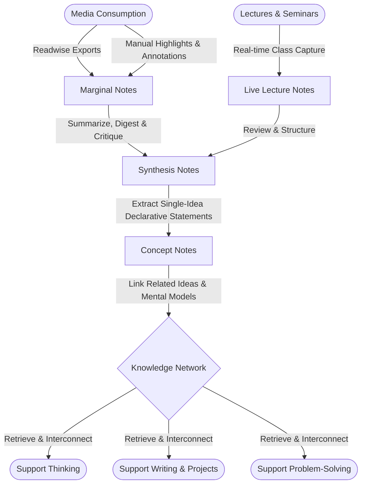

# zettelkasten-obsidain-notes-to-hugo-template

https://www.atlasworkspace.ai/blog/zettelkasten-method-guide

Notes managed by Obsidian and transpiled to HTML via Hugo static site generator.

# My Personal Knowledge Management (PKM) Workflow

This system adapts the **Zettelkasten method** to create a seamless pipeline from raw information intake to atomic, networked thinking. Rather than relying on rigid traditional terms, this workflow uses clear, functional stage names.

## 🗺️ The Process at a Glance

## 🔄 The 4-Stage Workflow

### Stage 1: Raw Capture & Intake

**Purpose:** Collect raw information with zero friction as you read, listen, or watch.

- **Marginal Notes & Highlights:** Quotes, annotations, and highlights automatically synced from Readwise (books, articles, web highlights).
- **Live Lecture Notes:** Fast-paced, minimal outline notes captured during live classes, presentations, or keynotes.
- **Characteristics:** Unfiltered, source-dependent, low-effort capture.

### Stage 2: Digest & Synthesis (_The Processing Hub_)

**Purpose:** Active comprehension. Translate external information into your own words before creating standalone concepts.

- **Synthesis Notes:** Structured notes created for every book, article, podcast, video, or lecture series consumed.
- **Core Components:**
  - Executive Summary & Core Thesis
  - Key Takeaways & Section Breakdown
  - Personal Reflection & Critical Commentary
  - **Concept Candidates:** A queue of atomic idea titles waiting to be spun out.
- **Characteristics:** Comprehensive, source-referenced, summarized in your own language.

### Stage 3: Conceptualization (_The Networked Brain_)

**Purpose:** Distill synthesized ideas into permanent, reusable mental building blocks.

- **Concept Notes:** Self-contained, single-idea notes written as **declarative statements** (e.g., _`[[Concept Note - Friction is a stronger behavior lever than motivation]]`_).
- **Key Principles:**
  - **Decoupled:** Completely separated from specific books, authors, or lectures.
  - **Atomic:** One distinct idea per note.
  - **Networked:** Linked directly to related Concept Notes to form interconnected clusters of thought across disciplines.

### Stage 4: Output & Creation (_Optional_)

**Purpose:** Utilize your networked Concept Notes to construct essays, research projects, articles, or presentations.

- **Projects / Target Notes:** Dynamic notes where related Concept Notes are assembled into structured outlines and final creative outputs.

## 💡 Summary Table

| **Stage**      | **Note Type**                     | **Function**                                           | **Source Dependent?**       |
| -------------- | --------------------------------- | ------------------------------------------------------ | --------------------------- |
| **1. Capture** | **Marginal Notes / Live Lecture** | Raw intake, annotations, and real-time class notes     | 🟢 High                     |
| **2. Process** | **Synthesis Notes**               | Summarizing, critiquing, and extracting core arguments | 🟡 Medium (Links to source) |
| **3. Network** | **Concept Notes**                 | Single, declarative ideas built for connection         | 🔴 Fully Decoupled          |
| **4. Output**  | **Project / Writing**             | Long-form articles, essays, and presentations          | 🟢 Context Specific         |
