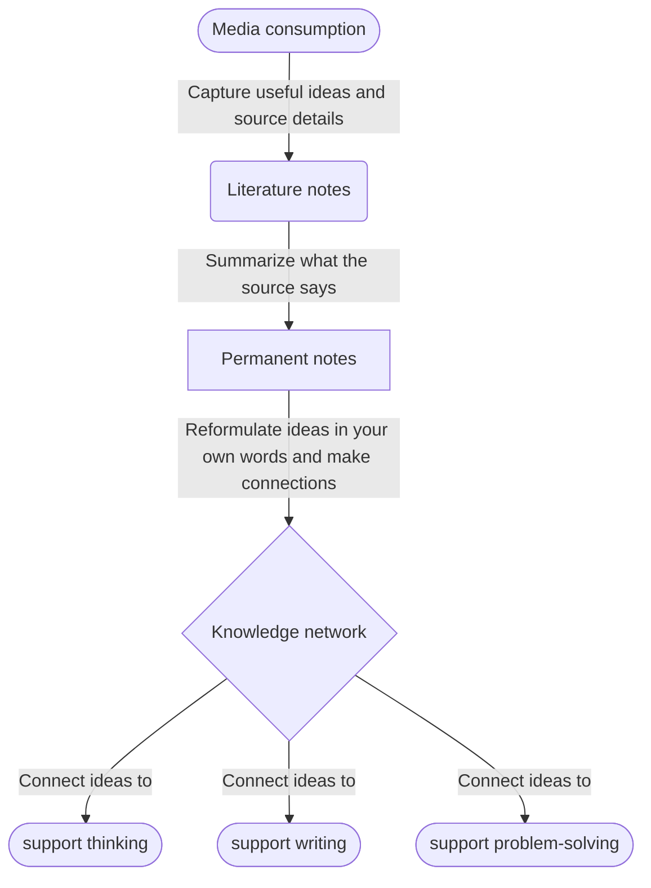

# zettelkasten-obsidain-notes-to-hugo-template

https://www.atlasworkspace.ai/blog/zettelkasten-method-guide

Notes managed by Obsidian and transpiled to HTML via Hugo static site generator.

"highlight" notes are all direct quotes and my reflection of direct quotes; and, I have "literature" notes that are written in my own words, summary of collection of highlights, abstractions, and key ideas of source material.

- **Highlights → Processed notes** (best conceptual distinction)
  - Zettelkasten / PKM style: **Processed notes** → contrasts nicely with raw highlights
- **Summary notes** → emphasizes synthesis of highlights

