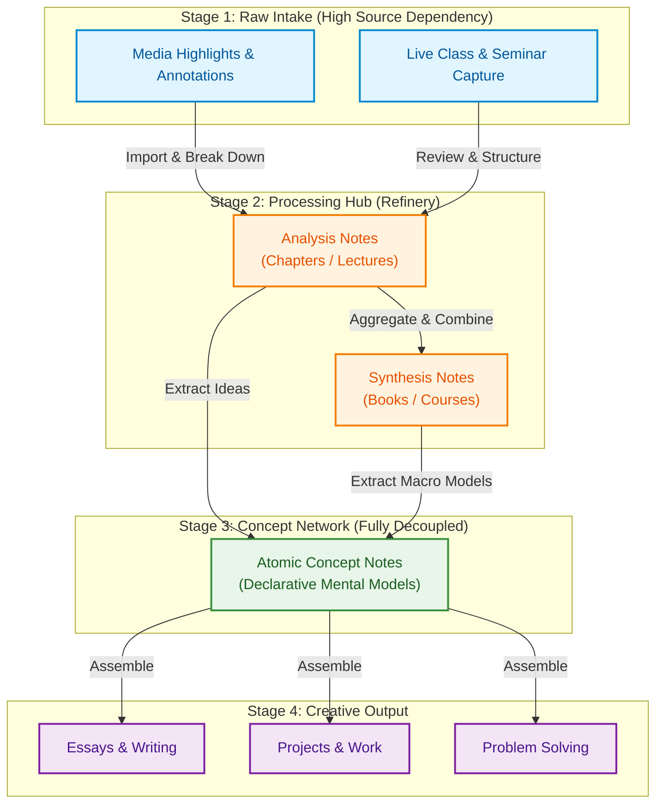

# zettelkasten-obsidain-notes-to-hugo-template

[https://matt2ology.github.io/](https://matt2ology.github.io/)

https://www.atlasworkspace.ai/blog/zettelkasten-method-guide

Notes managed by Obsidian and transpiled to HTML via Hugo static site generator.



## Setting up tests

### Install Vitest

Open the VS Code terminal and navigate to your vault directory.

```bash
npm init -y
npm install --save-dev vitest
```

Add this script to package.json:

```json
{
  "scripts": {
    "test": "vitest",
    "test:run": "vitest run"
  }
}
```

### Write a test

```javascript
import { describe, it, expect } from "vitest";
import TextFormatter from "../scripts/_quickadd/utils/text-formatter.js";

describe("TextFormatter.titleCase()", () => {
  it("capitalizes a single lowercase word", () => {
    expect(TextFormatter.titleCase("hello")).toBe("Hello");
  });

  it("capitalizes a single minor word", () => {
    expect(TextFormatter.titleCase("the")).toBe("The");
  });

  it("converts a sentence to title case", () => {
    expect(TextFormatter.titleCase("lord of the rings")).toBe(
      "Lord of the Rings",
    );
  });

  it("capitalizes the first word even when it is a minor word", () => {
    expect(TextFormatter.titleCase("the developer's guide to AI")).toBe(
      "The Developer's Guide to AI",
    );
  });

  it("preserves uppercase acronyms", () => {
    expect(TextFormatter.titleCase("artificial intelligence AI")).toBe(
      "Artificial Intelligence AI",
    );
  });

  it("handles empty strings", () => {
    expect(TextFormatter.titleCase("")).toBe("");
  });

  it("handles extra whitespace", () => {
    expect(TextFormatter.titleCase("  hello   world  ")).toBe("Hello World");
  });
});
```

### Run tests

In the VS Code terminal:

```bash
npm run test:run
```

To run tests automatically whenever you save a file:

```bash
npm test
```
