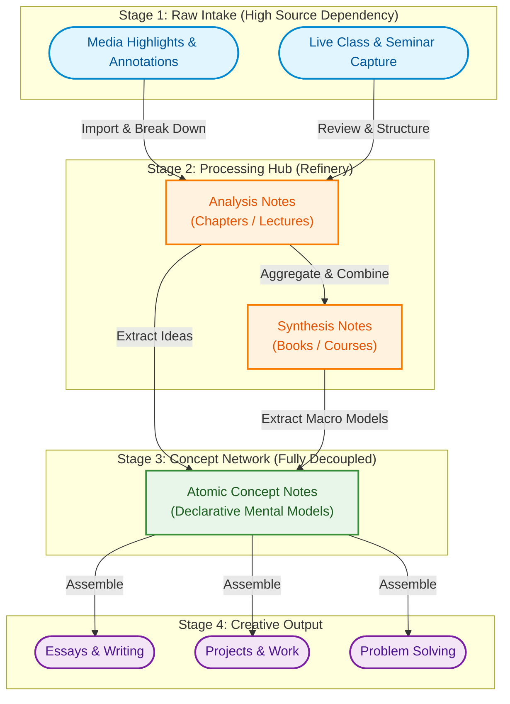

# zettelkasten-obsidain-notes-to-hugo-template

[https://matt2ology.github.io/](https://matt2ology.github.io/)

https://www.atlasworkspace.ai/blog/zettelkasten-method-guide

Notes managed by Obsidian and transpiled to HTML via Hugo static site generator.

## My Personal Knowledge Management (PKM) Workflow

This system adapts the **Zettelkasten method** to create a seamless pipeline from raw information intake to atomic, networked thinking. Rather than relying on rigid traditional terms, this workflow uses clear, functional stage names.

## 🗺️ The Process at a Glance



## 🔄 The 4-Stage Workflow

### Stage 1: Frictionless Capture

- **Goal:** Collect insights in real time without interrupting flow or overthinking structure.
- **Note Types:** Marginal notes, web quotes, book highlights (synced via Readwise), and rapid live lecture outlines.
- **Key Characteristic:** High source dependency, quick capture, zero organization required.

### Stage 2: Digest & Processing (Analysis vs. Synthesis)

- **Goal:** Active comprehension. Translate external knowledge into your own words before creating standalone concepts.
- **Architecture:** Uses a **Structural Separation** between breaking down parts and combining the whole:
  - **Analysis Notes (`analysis/`):** Breaking down individual granular parts (single chapters, specific lecture classes, individual podcast episodes, or standalone conference talks).
  - **Synthesis Notes (`synthesis/`):** Combining and summarizing the entire whole (full books, complete university courses, full podcast seasons/series, or entire multi-day conferences).
- **Key Feature:** Every analysis and synthesis note contains a **"Concept Candidates"** section, a staging ground for raw ideas waiting to be turned into permanent concept notes.

### Stage 3: Conceptualization (The Networked Brain)

- **Goal:** Distill processed insights into permanent, reusable building blocks.
- **Note Types:**
  - **Concept Notes:** Decoupled, single-idea atomic notes written as **declarative titles** (e.g., `[[Friction is a stronger behavior lever than motivation]]`).
  - **Maps of Content (MOCs):** Higher-level index pages that curate and group related Concept Notes around specific domains.
- **Key Principles:**
  - **Decoupled:** Completely independent of any specific author, book, or class.
  - **Atomic:** Focused on exactly one distinct idea or principle.
  - **Networked:** Hyperlinked to existing concept notes to form multi-disciplinary clusters.

### Stage 4: Output & Creation (_optional_)

- **Goal:** Retrieve and assemble networked concept notes into real-world deliverables.
- **Note Types:** Article outlines, research papers, project plans, decision logs, or presentations.
- **Key Characteristic:** Highly efficient creation. Rather than starting from scratch, projects are created by weaving together pre-existing, fully fleshed-out Concept Notes.

## 💡 Summary Overview

| **Stage**                  | **Note Type**                  | **Primary Function**                                  | **Source Dependency**                    | **Location / Directory** |
| -------------------------- | ------------------------------ | ----------------------------------------------------- | ---------------------------------------- | ------------------------ |
| **1. Capture**             | **Highlights & Live Outlines** | Quick, low-friction recording of raw inputs           | 🟢 **100% Source Dependent**             | `Readwise`, `capture`    |
| **2a. Analysis**           | **Chapter / Lecture**          | Deconstructing & analyzing individual parts           | 🟡 **High** (Linked to Synthesis Note)   | `analysis`               |
| **2b. Synthesis**          | **Book / Course**              | Combining parts into macro thesis & unified framework | 🟡 **Medium** (Linked to Analysis Notes) | `synthesis`              |
| **3. Network**             | **Atomic Concept Notes**       | Reusable mental models & declarative ideas            | 🔴 **Fully Decoupled**                   | `concepts`               |
| **4. Output** (_optional_) | **Projects & Writings**        | Essays, decision models, and deliverables             | 🔵 **Context-Specific**                  | `projects`               |

## Setting up tests

### Install Vitest

Open the VS Code terminal and navigate to your vault directory.

```bash
npm init -y
npm install --save-dev vitest
```

Add this script to package.json:

```json
{
  "scripts": {
    "test": "vitest",
    "test:run": "vitest run"
  }
}
```

### Write a test

```javascript
import { describe, it, expect } from "vitest";
import TextFormatter from "../scripts/_quickadd/utils/text-formatter.js";

describe("TextFormatter.titleCase()", () => {
  it("capitalizes a single lowercase word", () => {
    expect(TextFormatter.titleCase("hello")).toBe("Hello");
  });

  it("capitalizes a single minor word", () => {
    expect(TextFormatter.titleCase("the")).toBe("The");
  });

  it("converts a sentence to title case", () => {
    expect(TextFormatter.titleCase("lord of the rings")).toBe(
      "Lord of the Rings",
    );
  });

  it("capitalizes the first word even when it is a minor word", () => {
    expect(TextFormatter.titleCase("the developer's guide to AI")).toBe(
      "The Developer's Guide to AI",
    );
  });

  it("preserves uppercase acronyms", () => {
    expect(TextFormatter.titleCase("artificial intelligence AI")).toBe(
      "Artificial Intelligence AI",
    );
  });

  it("handles empty strings", () => {
    expect(TextFormatter.titleCase("")).toBe("");
  });

  it("handles extra whitespace", () => {
    expect(TextFormatter.titleCase("  hello   world  ")).toBe("Hello World");
  });
});
```

### Run tests

In the VS Code terminal:

```bash
npm run test:run
```

To run tests automatically whenever you save a file:

```bash
npm test
```
