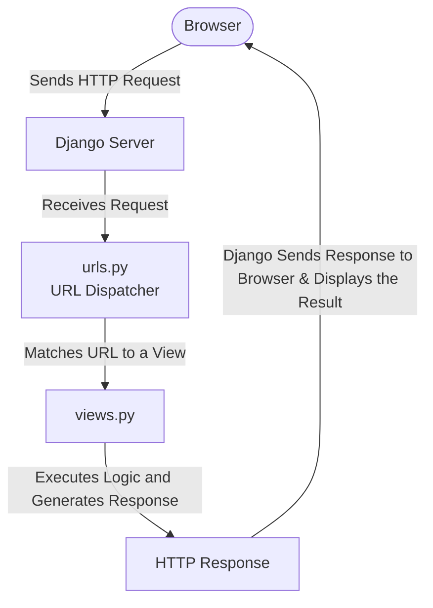

**Analysis:** [[03-django-6-fundamentals-creating-a-simple-web-page|Django 6 Fundamentals - Creating a Simple Web Page]]

## TL;DR (too long; didn't read)

> [!tldr] Django and the Flow of Control Summary
>
> A user makes a request, the Django web server processes it, and returns a response.
>
> To set a view function as the website's homepage, open **`project_name/urls.py`** and change the first argument of `path(arg1, arg2)` in the `urlpatterns` list to an empty string (`''`).

## Django and the Flow of Control

We can remap a view function to the website's index (homepage) in **`project_name/urls.py`** script, in the Python List, `urlpatterns` replace the first argument of the `path(arg1, arg2)` with an empty quote.

```
# project_name/urls.py
from django.contrib import admin
from django.urls import path, include

from django_app_name.views import view_function_name


urlpatterns = [
    path('admin/', admin.site.urls),
    path('', view_function_name),
]
```

What controls the flow of our code is the Django server process.

A web server does is to wait for incoming requests.

1. **Client sends a request:** The browser sends an HTTP request (typically GET) to the Django server for a specific URL.
2. **Django receives the request:** Django receives the incoming request and examines the requested URL.
3. **URL routing:** Django checks the URL configuration (`urls.py`) to find the matching URL pattern.
4. **View execution:** Django calls the corresponding view function in `views.py`.
5. **Response generation:** The view function processes the request and returns an HTTP response.
6. **Response delivery:** Django sends the HTTP response back to the browser.
7. **Content rendering:** The browser receives and displays the response to the user.


