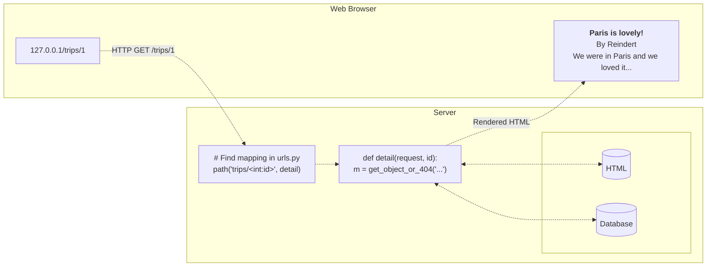

**Analysis:** [[03-django-6-structure-of-a-django-application|Django 6 - Structure of a Django Application]]

## TL;DR (too long; didn't read)

> [!tldr] The Model-Template-View Architecture Summary
>
> Django uses a variation of the "model-view-controller" architecture that is the "Model-Template-View" where:
> - **The Model (the data):** uses Python classes to represent tables in the database
> - **Templates:** to generate HTML - presentation for user
> - **View (the behavior):** brings everything together, map view functions fetch data to specific URLS, in `urls.py` for the templates to be displayed in HTML code via browser

## The Model-Template-View Architecture

The "Model-Template-View" model of Django has data, templates, views, and URLs; together, these components make up the core design pattern of every Django application.

The "Model-Template-View" model of Django is an variation of "model-view-controller" architecture.

## Model-Template-View Architecture

1. User visits the site and clicks on a post
2. The browser sends a request to get that page to the Django application
3. The Django server receives the request and looks up the mapping for this URL in **`urls.py`**
4. The Django server finds the line that maps the post URL to the detail view.
5. The detail view is a function defined in **`views.py`**
6. This function gets all data for the trip from the database and sends that data to a template
7. The HTML page gets created
8. The HTML gets sent back to the browser so that the user can read the post

### Model (Data)

A Django model class represents a table in the database

### Templates

Templates are used to generate HTML for website - present info to user

### View (Behavior)

Brings everything together:
- Python function mapped to URL

The corresponding view function fetches the data for any page a user visits to be given to the template and finally displayed on the browser.

Views are mapped to specific URLs in **`urls.py`**
