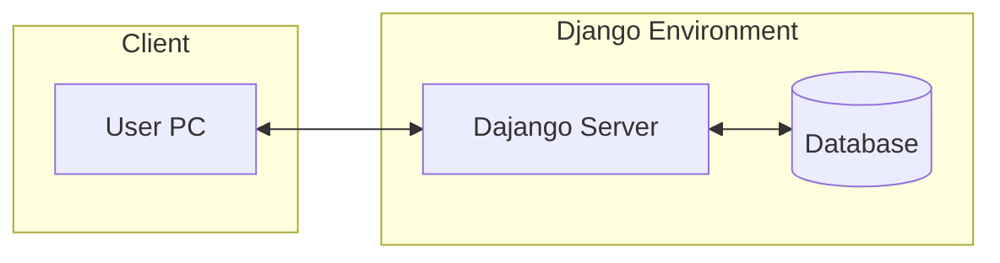
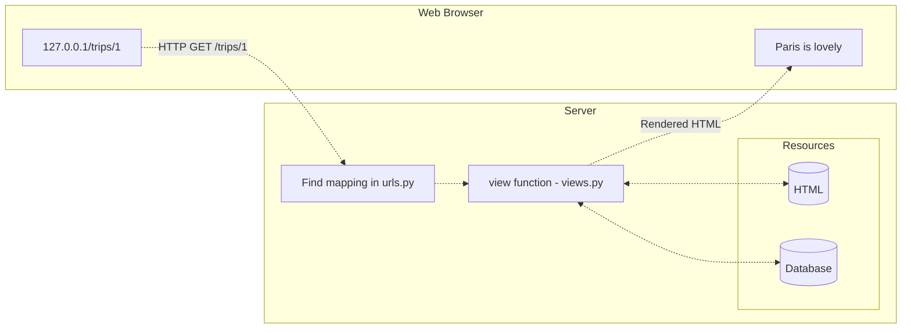
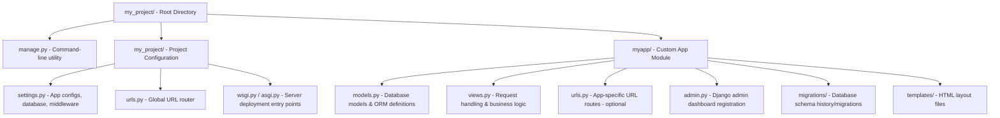

---
aliases:
  - "Synthesis of Django 6: The Big Picture by Reindert-Jan Ekker"
title: "Course Synthesis of Django 6: The Big Picture by Reindert-Jan Ekker"
date: 2026-11-13T16:35:03-08:00
draft: false
slug: django-6-the-big-picture
categories:
  - synthesis
  - courses
tags:
  - django
  - python
  - pluralsight
type: synthesis
domain: courses
instructor:
  - "[[reindert-jan-ekker|Reindert-Jan Ekker]]"
course: "Django 6: The Big Picture"
---

## Django 6: The Big Picture

**Course link:** [Django 6: The Big Picture by Reindert-Jan Ekker](https://www.pluralsight.com/courses/django-big-picture)

<!-- A 2-3 sentence summary of the main argument or purpose in your own words. -->

> [!summary] The Core Concept
>
> - [Django](https://www.djangoproject.com/) is [[../../../analysis/courses/django-6/02-django-6-introducing-django|a feature complete Python backend framework for web applications]]
> - [[../../../analysis/courses/django-6/03-django-6-structure-of-a-django-application|How Django works]]:
>   - "Model-Template-View" architecture
>     - **The Model (the data):** uses Python classes to represent tables in the database
>     - **Templates:** to generate HTML - presentation for user
>     - **View (the behavior):** brings everything together, map view functions fetch data to specific URLS, in `urls.py` for the templates to be displayed in HTML code via browser
>   - Structured directory
>     - Root folder is the Project folder
>     - The folder that shares the same name as the Project folder (i.e. `project_name/project_name`) contains the project's configuration files
>     - "Apps" are other files, components, subsets of the project
> - One should [[../../../analysis/courses/django-6/04-django-6-choosing-django|choose Django]] for an out-of-the-box, batteries included, experience for quick and robust web application development.

## Foundational Concepts

### Django is a backend framework

### [[../../../notes/courses/django-6/n07-django-6-structure-of-a-django-application-the-model-template-view-architecture|Model-Template-View Architecture]]

### [[../../../analysis/courses/django-6/03-django-6-structure-of-a-django-application|Structure of a Django Application]]

## Connections & Cross-References

[[00-django-6-fundamentals-synthesis|Django 6 Fundamentals]]
